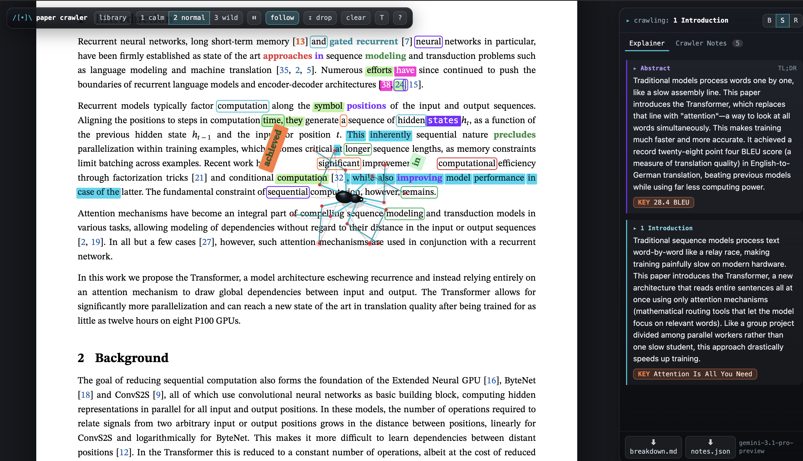

# Paper Crawler - a spider that reads ML papers

[](https://www.python.org/)
[](https://www.python.org/)
[](https://ai.google.dev/)

A spider crawls down an arXiv ML paper, marking up the words it walks over
(metrics glow, numbers blow up, datasets get boxed), while **Gemini** explains
each section in a plain-English side panel. When the model hands back the one
phrase that matters (`KEY: 28.4 BLEU`), the spider runs to that phrase and
puts a box around it. No dependencies, no build step - Python standard
library and ES modules.



## Features

### The spider

- **IK legs + tetrapod gait**: a canvas spider with inverse-kinematics legs that
  walks the paper from top to bottom
- **Markup brain**: metrics glow, numbers blow up, datasets get boxed, key
  phrases get highlighted - all painted with `::before` bars so the page never
  reflows under the spider's feet
- **Steerable**: click anywhere to send it there, or drop it again with `D`

### Paper library

- **Your papers**: everything in `papers/`, searchable by title, id or author
- **Add a paper**: type an arXiv id or URL (`1706.03762`,
  `https://arxiv.org/abs/1810.04805`) - the server downloads it from arXiv
  and streams the progress back
- **Table of contents**: click a section and the spider sprints there; the
  explainer picks the section up on the way

### AI explainer

- **Plain English**: Gemini explains each section in under 70 words, with a
  `KEY:` line naming the one phrase that matters
- **Three levels**: beginner (CS freshman), student (knows basic ML),
  researcher (precise and technical)
- **Explain a selection**: select any passage and press `E`
- **Crawler Notes**: metrics, models and datasets the spider touched
- **Export**: download a Markdown breakdown or the notes as JSON

### Remembers you

- **Resume**: the paper, the reading level, the scroll position and the section
  the spider was in are kept in `localStorage`, so opening the app drops you
  back where you were
- **Shareable URL**: `?paper=1706.03762&level=researcher`

### Safe by default

- **Key stays on the server**: `GEMINI_API_KEY` is read from `.env` and never
  reaches the browser
- **Static allowlist**: only `index.html`, `css/`, `js/` and `papers/` are
  served - `.env`, `cache/` and `serve.py` return 404
- **Content-Security-Policy**: a downloaded paper can show its figures but
  cannot run its own scripts

## Tech stack

### Backend

- **Python standard library only** (`http.server`, `urllib`, `json`, …) -
  no pip, no virtualenv
- **`serve.py`**: static host, `/api/explain` (Gemini proxy, SSE streaming),
  `/api/fetch` (arXiv download, SSE progress), `/api/papers`, `/api/status`
- **Model pool**: a chain of Gemini models with automatic fallback, quota
  parking and cooldowns

### Frontend

- **Vanilla JS ES modules** - no framework, no bundler
- **`loader.js`**: cleans the arXiv HTML, lazily wraps words, indexes sections
- **`crawler.js`**: IK legs, tetrapod gait, the markup brain
- **`spider-draw.js`**: canvas painting only
- **`analyst.js`**: the Gemini panel, Crawler Notes, Markdown/JSON export
- **`library.js`**: the paper drawer
- **`main.js`**: wiring + keyboard + "where you left off"
- **`css/style.css`**: LaTeXML theme + the `.m-*` markup effects

## Quick start

### Prerequisites

- Python 3.9+
- A Gemini API key (free from <https://aistudio.google.com/>)

### Installation

1. **Clone the repository**

   ```bash
   git clone https://github.com/yourusername/paper-crawler.git
   cd paper-crawler
   ```

2. **Add your API key**

   ```bash
   echo "GEMINI_API_KEY=your-key-here" > .env
   ```

3. **Run it**

   ```bash
   python3 serve.py
   ```

   Open <http://localhost:5173>. The drawer opens on its own - type an arXiv
   id (e.g. `1706.03762`) and press Enter.

### Pre-download a paper from the terminal

```bash
python3 fetch_paper.py 1706.03762
python3 fetch_paper.py --batch "1706.03762 2005.14165"
python3 fetch_paper.py https://arxiv.org/abs/1810.04805
```

No dependencies, no build step.

## Usage

### Adding a paper

Open the library drawer (`L`), type an arXiv id or URL, and press Enter. The
server downloads the HTML and metadata from arXiv, rewrites the figure URLs to
absolute addresses, and the paper appears in your library.

### Reading

The spider drops onto the paper and walks down it, marking up the words it
passes. It emits a `section` event on each new section, which queues a Gemini
explanation. Switch levels with `B` / `S` / `R`.

### Jumping to a section

Open the drawer (`L`) and click any entry in "this paper". The spider sprints
there and the explainer picks the section up on the way.

## Architecture

The spider's frame loop is strict: **read → update → draw → commit**. Nothing
in `update`/`draw` touches the DOM; every write is queued and applied in
`commit`, so the page never reflows under the spider's feet.

```
spider enters a section
  -> crawler emits "section"             (binary search over heading positions)
  -> Analyst.onSection() queues a job    (one request at a time)
  -> POST /api/explain {title, section, text, level}   (serve.py holds the key)
  -> serve.py streams Gemini's answer back as SSE       (typed out live)
  -> the last line is "KEY: <exact phrase>"
  -> we find that phrase in the paper and send the spider to it
```

## Project structure

```
paper-crawler/
├── serve.py            # static host + /api/explain + /api/fetch + model pool
├── fetch_paper.py      # arXiv -> papers/<id>.html + <id>.json
├── index.html          # the shell
├── css/style.css       # LaTeXML theme + the .m-* markup effects
├── js/
│   ├── loader.js       # cleans the arXiv HTML, lazily wraps words, indexes sections
│   ├── crawler.js      # IK legs, tetrapod gait, markup brain
│   ├── spider-draw.js  # canvas painting only
│   ├── analyst.js      # Gemini panel, Crawler Notes, Markdown/JSON export
│   ├── library.js      # the paper drawer
│   └── main.js         # wiring + keyboard + "where you left off"
├── papers/             # downloaded papers (gitignored)
├── cache/              # cached explanations (gitignored)
└── .env                # GEMINI_API_KEY (gitignored)
```

## Development

### Available scripts

```bash
python3 serve.py              # start the server (http://localhost:5173)
python3 fetch_paper.py <id>   # download a paper
python3 -m py_compile serve.py fetch_paper.py   # syntax check
```

### Code quality

- **Standard library only** - no pip, no virtualenv, no build step
- **ES modules** in the browser - `import`/`export`, no bundler
- **Strict frame loop** - read → update → draw → commit

### Keyboard shortcuts

| key         | what it does                                             |
| ----------- | -------------------------------------------------------- |
| `L`         | library: your papers, the table of contents, add a paper |
| `Space`     | pause / resume the spider                                |
| `F`         | camera follow                                            |
| `T`         | title caption                                            |
| `1` `2` `3` | markup intensity                                         |
| `B` `S` `R` | explain at beginner / student / researcher level         |
| `E`         | explain the selected passage                             |
| `C`         | clear the markup                                         |
| `D`         | re-drop the spider                                       |
| `?`         | the keyboard list                                        |
| `Esc`       | close the drawer / the help                              |

`?debug=1` shows the IK skeleton, the foot targets, an FPS counter and
exposes `window.__crawler` / `window.__analyst` in the console.

## Deployment

This is a local tool by design: it proxies your Gemini quota, so keep
`HOST=127.0.0.1` (the default). To run it on another port:

```bash
PORT=8080 python3 serve.py
```

## Contributing

1. Fork the repository
2. Create a feature branch (`git checkout -b feature/amazing-feature`)
3. Make your changes
4. Run `python3 -m py_compile serve.py fetch_paper.py` and check the browser
   console for errors
5. Commit your changes (`git commit -m 'Add amazing feature'`)
6. Push to the branch (`git push origin feature/amazing-feature`)
7. Open a Pull Request

### Code standards

- Follow the existing code style (no comments unless necessary)
- Keep the frame loop strict: read → update → draw → commit
- Never commit `.env`, `papers/` or `cache/`

## API documentation

### Endpoints

- `GET /api/papers` - list of downloaded papers (reads `papers/*.json`)
- `GET /api/status` - `{"hasKey": bool, "model": "...", "quotaReset": 0}`
- `POST /api/explain` - ask Gemini to explain a section, streamed as SSE
- `POST /api/fetch` - download a paper from arXiv, streamed as SSE progress

### SSE messages (`/api/explain`)

- `{"type":"text", "text":"..."}` - a chunk of the answer
- `{"type":"reset"}` - a model died mid-answer
- `{"type":"done", "cached":bool, "model":"..."}` - finished
- `{"type":"error", "code":"...", "message":"...", "resetAt":...}` - failure

## Security

- **Authentication**: none needed - it is a single-user local tool
- **API key**: read from `.env`, never sent to the browser, never logged
- **Static files**: allowlist on the _resolved_ path, so `../` tricks can't
  reach `.env` / `cache/` / `serve.py`
- **Content-Security-Policy**: a downloaded paper can show its figures but
  cannot run its own scripts; the page cannot be framed
- **Host binding**: `127.0.0.1` by default - do not bind to `0.0.0.0`
  without adding authentication

## Troubleshooting

### Common issues

**"No papers yet"**

```bash
python3 fetch_paper.py 1706.03762
```

or add one from the library drawer (`L`).

**"AI explainer is off: no GEMINI_API_KEY"**

Create a `.env` file next to `serve.py`:

```
GEMINI_API_KEY=your-key-here
```

and restart `serve.py`.

**A model returns 429 / out of quota**

The server parks that model family until the reset time Google reports
(`Please retry in 12h14m32s`). Other buckets in the chain keep working; the
drawer footer shows "model · resets in Xh".

**Build fails with module not found**

There is no build step. If the browser shows a 404 for a `.js` file, check
that you are serving from the project root and that the file exists.

## Acknowledgments

- [arXiv](https://arxiv.org/) and [LaTeXML](https://math.nist.gov/~BMiller/LaTeXML/) - the paper HTML
- [Gemini](https://ai.google.dev/) - the explanations
- [ThreadingHTTPServer](https://docs.python.org/3/library/http.server.html) -
  the whole backend, in the standard library

## Support

- **Issues**: [GitHub Issues](https://github.com/yourusername/paper-crawler/issues)

---

Built with ❤️ by [Advaith R Pai](https://github.com/aridepai17)
